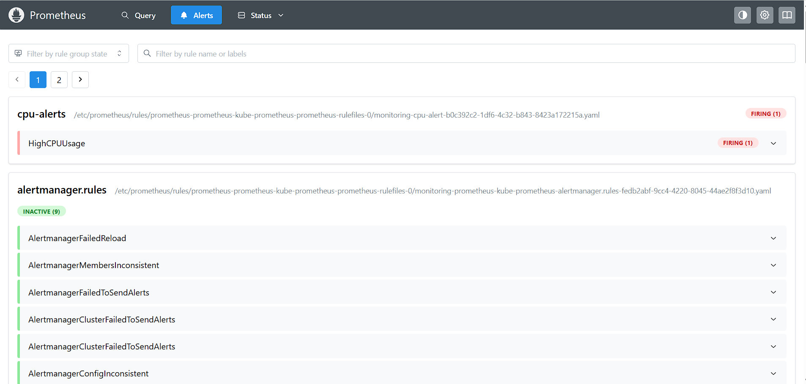
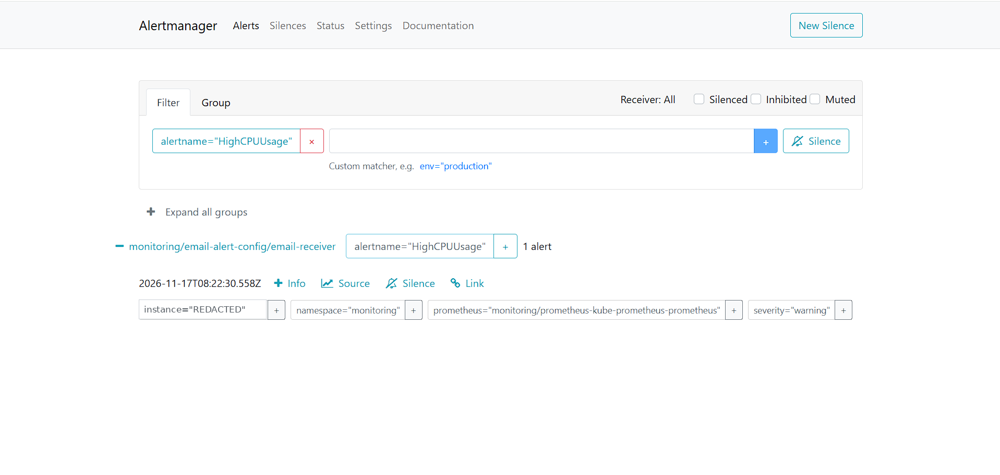
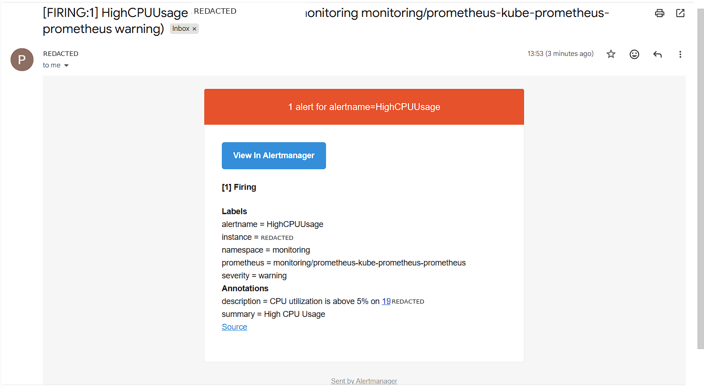
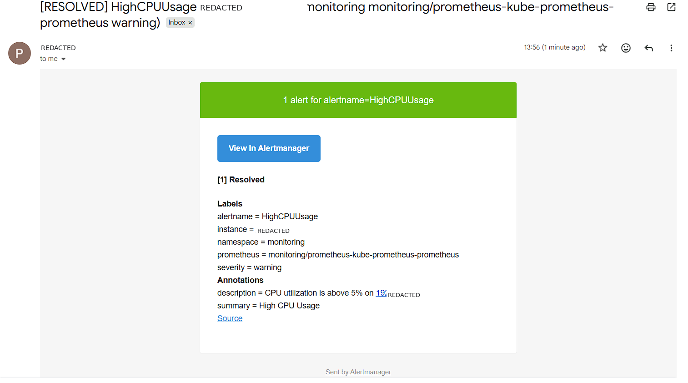

# Prometheus & Alertmanager Email Alerting

## Overview

Implemented email-based alert notifications using Prometheus and Alertmanager in Kubernetes.

This implementation demonstrates how Prometheus detects CPU threshold violations and sends alerts to Alertmanager, which delivers email notifications through Gmail SMTP.

Both firing and resolved email notifications are demonstrated.

## Technologies Used

- Kubernetes
- Prometheus
- Prometheus Operator
- Alertmanager
- Gmail SMTP
- YAML


## Prerequisites

Before implementing this setup, ensure the following components are available:

- A running Kubernetes cluster.
- Prometheus Operator installed in the cluster.
- Prometheus and Alertmanager deployed and configured.
- Node Exporter metrics available for CPU monitoring.
- A Gmail account with 2-Step Verification enabled.
- A Gmail App Password for SMTP authentication.
- A Kubernetes Secret named `gmail-smtp-secret` in the `monitoring` namespace, containing the SMTP password under the key `password`.

**Note:** The CPU alert threshold is set to 5% for demonstration purposes to make alert triggering easier during testing.


## Configuration Files

| File Path | Description |
|---|---|
| `alerting/cpu-alert.yml` | Defines the `HighCPUUsage` alert using PrometheusRule. |
| `alerting/alertmanager-email.yml` | Configures email notifications using AlertmanagerConfig and Gmail SMTP. |


## Deployment & Testing

### 1. Create Gmail SMTP Secret

Create a Kubernetes Secret to store your Gmail App Password securely.

```bash
kubectl create secret generic gmail-smtp-secret \
  --from-literal=password='<YOUR_GMAIL_APP_PASSWORD>' \
  -n monitoring
```

Verify the Secret:

```bash
kubectl get secret gmail-smtp-secret -n monitoring
```

### 2. Apply Prometheus Alert Rule

Deploy the CPU alert rule:

```bash
kubectl apply -f alerting/cpu-alert.yml
```

Verify the PrometheusRule:

```bash
kubectl get prometheusrule -n monitoring
```

### 3. Apply Alertmanager Email Configuration

Deploy the email notification configuration:

```bash
kubectl apply -f alerting/alertmanager-email.yml
```

Verify the AlertmanagerConfig:

```bash
kubectl get alertmanagerconfig -n monitoring
```

### 4. Test Email Notifications

- Generate CPU load on a monitored node to trigger the `HighCPUUsage` alert.
- Verify that the alert enters the firing state in Prometheus.
- Check Alertmanager to confirm that it receives the alert.
- Verify that a firing email notification is received.
- Stop the CPU load and allow the alert condition to clear.
- Verify that a resolved email notification is received.

**Note:** Ensure Prometheus is configured to discover the PrometheusRule and AlertmanagerConfig resources, and that Node Exporter CPU metrics are available before testing.


## Alert Configuration

- Alert Name: `HighCPUUsage`
- Condition: CPU utilization above 5%
- Evaluation Duration: 1 minute
- Severity: Warning

## Email Notification Configuration

- SMTP Server: `smtp.gmail.com:587`
- TLS: Enabled
- Receiver: Gmail
- Repeat Interval: 1 hour
- Resolved Notifications: Enabled

## Alerting Workflow

1. Prometheus continuously collects CPU metrics.
2. Prometheus evaluates the configured alert rule.
3. When CPU utilization exceeds the configured threshold, the alert enters the firing state.
4. Prometheus forwards the alert to Alertmanager.
5. Alertmanager sends an email notification through Gmail SMTP.
6. When the alert condition clears, Alertmanager sends a resolved notification.

### Architecture

```text
CPU Metrics
     |
     v
 Prometheus
     |
     v
 Alert Rule
     |
     v
 Alertmanager
     |
     v
 Gmail SMTP
     |
     v
 Email Notification
 (Firing / Resolved)
```

## Screenshots

### 1. Prometheus Alert Firing

Shows the HighCPUUsage alert in the firing state.




### 2. Alertmanager

Shows the alert received and grouped by Alertmanager.




### 3. Firing Email Notification

Demonstrates the email notification received when the CPU alert fires.





### 4. Resolved Email Notification

Demonstrates the recovery notification received after the alert condition clears.





## Security

- SMTP credentials are stored in a Kubernetes Secret.
- Gmail App Passwords are not stored directly in configuration files.
- Sensitive information is excluded from this repository.

## Outcome

Successfully demonstrated end-to-end email alerting using Prometheus and Alertmanager, including both firing and resolved notifications.
